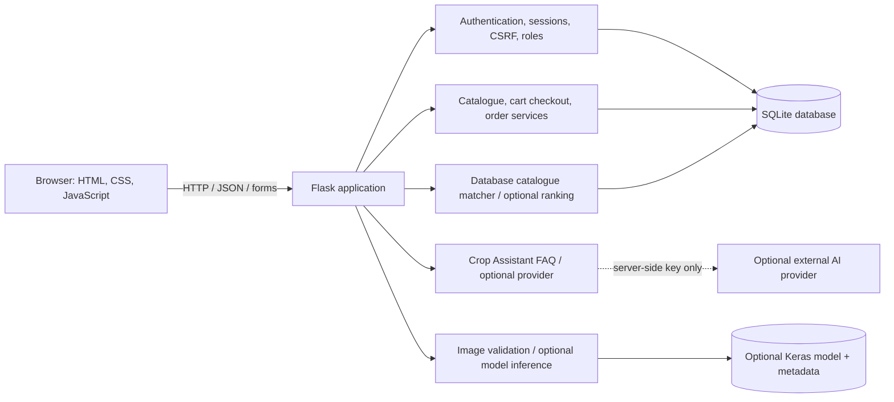
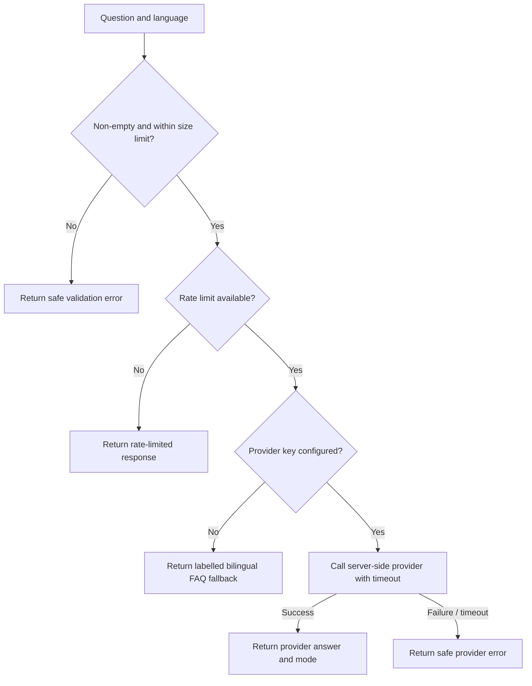
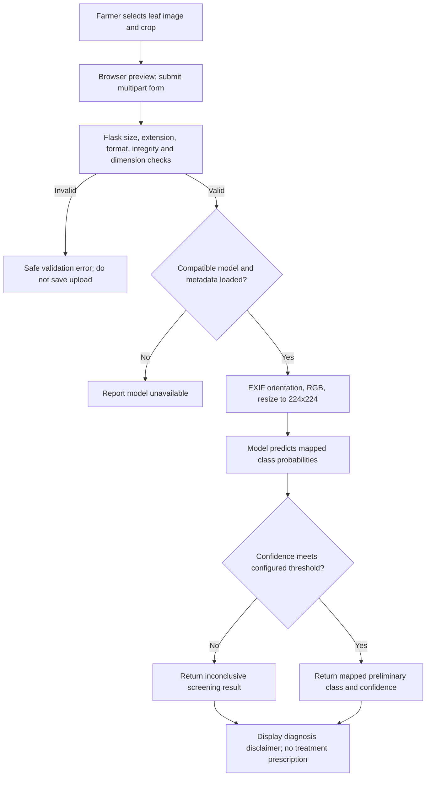

# JAGAN FERTILIZER — Project Report

## 1. Abstract
JAGAN FERTILIZER is a bilingual English/Telugu agricultural e-commerce
prototype implemented with Flask, SQLite, HTML, CSS and JavaScript. It
provides a searchable catalogue, customer accounts, an inventory-aware order
request workflow, an administrator interface, educational crop-care
assistance, rule-based product discovery, and an optional plant-leaf image
classification integration. Product prices and stock are validated by the
server. Orders are requests for shop confirmation; the application does not
process payments.

The Crop Assistant uses a limited FAQ fallback unless a server-side
OpenAI-compatible provider is configured. Product matching retrieves existing
catalogue entries rather than generating products. The image-classification
pipeline is documented, but no trained model, class map, dataset, or disease
evaluation is installed. Therefore, this report makes no disease accuracy or
agronomic outcome claim.

## 2. Introduction
Farmers may need to find local agricultural inputs and access understandable
general crop-care information. This project demonstrates how a small web
application can combine a product catalogue and order-request workflow with
bilingual educational tools. It is an academic prototype, not a substitute
for official product labels, laboratory soil testing, or advice from a
qualified agriculture professional.

## 3. Problem statement
The project explores a single interface for viewing available products,
submitting an order request, and finding general agricultural information in
English or Telugu. It must keep product, price, stock, customer and order
records on the server and avoid presenting unverified product or AI claims as
agricultural facts.

## 4. Objectives
- Build a responsive, bilingual catalogue with search and category filters.
- Allow customers to register, sign in, retain a cart in the browser, and
  submit orders whose prices and stock are checked by the server.
- Keep order history private to the owning customer and restrict administration
  to authorized accounts.
- Provide a bounded bilingual FAQ/optional AI assistant and catalogue-only
  product discovery.
- Prepare an image classification interface and training pipeline that clearly
  reports when a usable model is not available.
- Validate the core workflows with automated tests isolated from the shop
  database.

## 5. Existing system and limitations
The prototype initially evolved from a product catalogue into a
Flask/SQLite application with authentication, orders, administration and
agricultural assistance. A small starter database contains example products.
The architecture is suitable for a local student demonstration but lacks
operational features expected of a public commerce service.

Current limitations include unverified starter prices and product records,
no payment processing, no production deployment or restore drill, process-
local rate limits, no account recovery or email verification, and no
installed/trained disease classifier. The external AI provider has not been
configured or tested against a live service in this environment.

## 6. Proposed system
The proposed prototype keeps the browser responsible for presentation and
local cart/language preferences, while Flask validates requests and reads
trusted product, account and order data from SQLite. The administrator
interface uses server-side role checks. Agricultural outputs are described as
educational or preliminary; product discovery is not a crop prescription.

## 7. System architecture


### Main components
- **Presentation:** Jinja templates, responsive CSS, JavaScript, and English/
  Telugu translation dictionaries.
- **Application/API:** Flask routes validate browser input and apply product,
  order, account and administrator rules.
- **Persistence:** Flask-SQLAlchemy and SQLite store products, users, orders,
  order items and login-attempt state.
- **Crop Assistant:** FAQ-based fallback, with an optional server-side
  OpenAI-compatible provider.
- **Recommendations:** rule-based matching against available catalogue
  listings; optional provider ranking is limited to matched database IDs.
- **Disease screening:** Pillow validation and optional Keras model inference.
  Model training is a separate command-line process.

## 8. Module descriptions
### Product catalogue
The product API returns active listings and hides unverified crop-protection
products. The browser searches and filters returned products and displays
database-backed English/Telugu details, pack size, availability, and local
category illustrations. No genuine shop product photos or verified brands
were supplied. Five requested sample prices are stored as demo prices and
cannot be checked out until the shop verifies them; unverified stock is not
presented as available.

### Accounts and administration
Customer passwords are stored as Werkzeug password hashes. Session-based
authentication protects customer order history. Administrators are created
with the interactive `flask --app app create-admin` command. Server-side role
checks protect management pages and APIs.

### Cart and order requests
The cart is stored in browser local storage. Checkout sends product IDs and
quantities; the backend calculates prices from database values, validates
availability, and atomically reduces stock and creates the order/order items.
Payment is not collected and must be arranged with the shop.

### AI Crop Assistant
Without provider credentials, a limited bilingual FAQ provides general
education. With provider credentials, the configured server-side
OpenAI-compatible provider can answer within a timeout. Provider API keys are
not sent to browser code. The assistant does not diagnose a crop or prescribe
generic fertilizer/pesticide rates.

### Product recommendations
The fallback performs transparent keyword/catalogue matching against active,
available database products. It excludes unverified crop-protection items and
does not infer suitability unsupported by catalogue data. An optional provider
may rank candidates already selected by the rules; product details and prices
remain database-sourced. Recommendations are discovery leads, not
agronomic prescriptions.

### Disease recognition
The upload API accepts limited JPG/JPEG/PNG files, checks image content and
dimensions, decodes images in memory, and does not persist uploads. The
optional classifier contract uses a 224×224 RGB input and class metadata. A
low-confidence model result is inconclusive. The application currently
reports that no model is installed; there is no verified dataset, class
coverage, training result, test accuracy, or field evaluation to report.

## 9. Database design
| Entity | Important fields | Purpose |
|---|---|---|
| `Product` | `id`, `name`, `category`, `description`, `description_te`, `brand`, `brand_verified`, `price`, `unit`, `stock`, `stock_verified`, `image`, `guidance_en`, `guidance_te`, `active`, `price_verified`, `is_demo_price`, `registration_verified` | Catalogue and inventory; verification flags gate brand/price/stock display and order use. |
| `User` | `id`, `full_name`, unique `identity`, `identity_type`, `password_hash`, `role`, `is_active`, `created_at` | Customer/admin identity and authorization. |
| `Order` | `id`, nullable `user_id`, `order_reference`, customer contact/address, `notes`, `items_json`, `total`, `status`, `created_at` | Order snapshot and status; nullable owner preserves legacy/anonymous orders. |
| `OrderItem` | `id`, `order_id`, nullable `product_id`, `product_name`, `quantity`, `unit_price`, `subtotal` | Immutable item/price snapshot belonging to an order. |
| `LoginAttempt` | hashed key, failure count, window start, lock expiry | Short-window login throttling state. |

`Order` has a one-to-many relationship with `OrderItem`; orders may reference a
customer, while legacy anonymous orders remain unassigned. Additive migrations
add missing columns and backfill legacy item rows without deleting orders.

## 10. Workflow and algorithms
### Customer shopping workflow
```mermaid
sequenceDiagram
    actor Farmer
    participant UI as Browser
    participant API as Flask
    participant DB as SQLite
    Farmer->>UI: Search/filter and add products
    UI->>UI: Store cart IDs/quantities locally
    Farmer->>UI: Submit contact details and order
    UI->>API: Product IDs, quantities, CSRF token
    API->>DB: Read current products and verified prices
    API->>DB: Transaction: check stock, decrement, save order/items
    DB-->>API: Commit or rollback
    API-->>UI: Order reference, safe error, or stock issue
    UI-->>Farmer: Confirmation; shop confirms arrangements
```

The server validates customer data, product identity, quantity, active status,
verified price and stock. It recomputes subtotals and total using trusted
database prices. A failed validation rolls back the transaction.

### Crop Assistant workflow


### Recommendation workflow
The endpoint validates crop, stage, language and bounded free-text fields,
queries active available catalogue rows, filters out unverified crop-protection
listings, and matches catalogue descriptions/guidance with the request. An
optional provider can reorder only the database candidate IDs. The server
returns details and verified prices from database rows; an empty match is
reported without inventing products.

### Disease detection workflow


The training utility uses TensorFlow/Keras MobileNetV2 transfer learning,
pre-split train/validation/test data, explicit class mapping, and a held-out
test evaluation. The project currently has no selected dataset, so source,
license, class list and metrics are unavailable rather than assumed.

## 11. Testing methodology and results
Automated tests use Flask's test client and a forced in-memory SQLite database.
They cover storefront/search, authentication and password hashing, customer
order ownership, checkout totals and stock rollback, administrator access and
mutations, assistant fallback/provider errors, catalogue matching, image
validation/fake-model behavior, and preservation of legacy data through an
additive migration test using a disposable database file.

**Executed results (Windows, Python 3.13, 2026-10-27):**
- `.\.venv\Scripts\python.exe -m unittest discover -s tests -v`: 34 tests
  passed, exit code 0.
- Python compilation of the Flask app, training script and all tests passed.
- The training utility help command completed; TensorFlow training was not
  started.
- Waitress was started against a disposable SQLite database. The homepage
  returned HTTP 200, the catalogue returned four seeded products, the chat API
  identified FAQ fallback mode, and the disease API correctly reported no
  installed model.
- Browser verification confirmed English/Telugu switching and persistence,
  no horizontal overflow at a 375-pixel viewport, cart quantity/state behavior,
  product details dialog behavior, and disabled disease submission without a
  model.
- The live shop database file fingerprint was the same before and after the
  isolated tests.

The test runner emitted non-fatal `ResourceWarning` messages during teardown
and mocked provider response handling; there were no test failures in the
final suite run. Pytest was not available in this environment, and package
installation was blocked by a reset package-index connection. The suite was
run successfully with the standard-library unittest runner. A live external
AI provider and real disease model cannot be tested without credentials and
model artifacts.

Manual browser verification is separate from automated tests. The page-level
checks cover language persistence, responsive layout, cart actions, product
details and the visible no-model state. Production deployment, public HTTPS,
external AI availability and field classification performance have not been
tested.

## 12. Security considerations
- The direct local runner has debug mode disabled. Production requires
  `APP_ENV=production` and a private `SECRET_KEY`; session cookies are Secure
  in that mode.
- Password hashes, session-bound CSRF checks, server-side role checks, input
  limits, database-calculated checkout totals and image validation are used.
- `.env`, databases, model binaries, logs and virtual environments are
  excluded from version control by `.gitignore`. `.env.example` has only
  placeholders.
- In-memory rate limiting is not shared across multiple processes/instances.
  Configure a shared rate limiter before public multi-worker service.
- Set up HTTPS, trusted secret storage, restrictive network rules, structured
  non-sensitive logs, error monitoring, backups and restore testing before
  public launch. The app has not undergone deployment penetration testing or
  an external compliance review.
- Do not publish until product/price correctness, privacy and data retention,
  backup recovery, deployment configuration and applicable Indian
  e-commerce/agriculture requirements have been reviewed.

## 13. Limitations and future scope
Future work may add a shared production rate limiter, audited administration,
account recovery and email verification, a reviewed privacy/retention policy,
automated backup/restore monitoring, and a licensed disease dataset with
group-based splits and local field validation. Any disease results must be
reported with actual class coverage and evaluation results; no such values
exist for this checkout.

## 14. Conclusion
JAGAN FERTILIZER demonstrates a bilingual agricultural catalogue and order
workflow with customer/admin roles and bounded agricultural information
features. Its automated checks exercise the key application paths in an
isolated test database. It remains a prototype: the optional AI integrations
are not live-validated, no disease model is installed, and public deployment
is not claimed.

## 15. References
- Flask documentation: https://flask.palletsprojects.com/
- Flask-SQLAlchemy documentation: https://flask-sqlalchemy.palletsprojects.com/
- SQLAlchemy documentation: https://docs.sqlalchemy.org/
- Pillow documentation: https://pillow.readthedocs.io/
- NumPy documentation: https://numpy.org/doc/
- TensorFlow: https://www.tensorflow.org/
- Keras: https://keras.io/
- Waitress: https://docs.pylonsproject.org/projects/waitress/
- Dataset: none selected or bundled for this project; consequently no dataset
  source or license can be cited.
